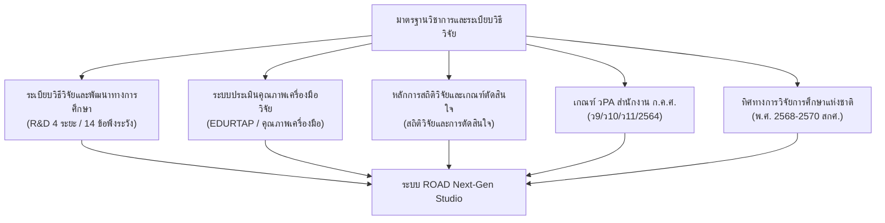

# เอกสารข้อเสนอโครงการเพื่อนำเสนอผู้เชี่ยวชาญและคณะกรรมการผู้ทรงคุณวุฒิ
## (Project Technical & Methodological Proposal for Expert Review)

---

### ชื่อโครงการ (Project Title)
**ROAD Next-Gen · R&D Research Studio & AI Co-Pilot**  
*(Report Outline Assistant for Development & AI Research Studio)*  
**"ระบบสตูดิโอออกแบบโครงร่างและจัดทำรายงานการวิจัยและพัฒนานวัตกรรมการศึกษา 5 บท อิงเกณฑ์ วPA และระเบียบวิธีวิจัยเชิงระบบ"**

---

### ข้อมูลเบื้องต้นของโครงการ (Executive Summary)
| ประเด็น | รายละเอียด |
| :--- | :--- |
| **ประเภทผลิตภัณฑ์** | เว็บแอปพลิเคชันเพื่อการวิจัยและการพัฒนาวิชาชีพทางการศึกษา (Educational Research Workspace & AI Co-Pilot) |
| **กลุ่มเป้าหมายหลัก** | ครูผู้สอน, ศึกษานิเทศก์, ผู้บริหารสถานศึกษา, อาจารย์, นักศึกษาระดับบัณฑิตศึกษา และบุคลากรทางการศึกษา |
| **ระดับวิทยฐานะเป้าหมาย** | ครูชำนาญการ (คศ.2), ชำนาญการพิเศษ (คศ.3), เชี่ยวชาญ (คศ.4) จนถึงเชี่ยวชาญพิเศษ (คศ.5) ตามเกณฑ์ วPA |
| **สถาปัตยกรรมทางเทคโนโลยี** | Vanilla JavaScript (Zero-Dependency), Node.js Built-in HTTP Server, Modern 3D Neumorphic Soft UI |
| **ความพร้อมในการใช้งาน** | ทำงานได้ทั้งแบบ Standalone (เปิดไฟล์ตรง), Local Server, และคลาวด์แพลตฟอร์ม (Vercel Edge SPA) |

---

## 1. ความเป็นมา ความสำคัญ และสภาพปัญหา (Rationale & Problem Statement)

จากการสำรวจและสังเกตการณ์การทำผลงานทางวิชาการและงานวิจัยในชั้นเรียนของครูและบุคลากรทางการศึกษาไทย พบปัญหาเชิงระเบียบวิธีวิจัย (Methodological Pitfalls) ที่เกิดขึ้นซ้ำซ้อนอย่างมีนัยสำคัญ ได้แก่:

1. **ความสับสนเชิงแบบแผนการวิจัย:** ผู้ทำวิจัยจำนวนมากสับสนระหว่าง **"การวิจัยเชิงปฏิบัติการในชั้นเรียน (Classroom Action Research - CAR)"** กับ **"การวิจัยและพัฒนา (Research and Development - R&D)"** โดยมักนำชื่อกิจกรรมย่อยมาตั้งเป็นนวัตกรรมโดยขาดหลักการ/ทฤษฎีเชิงระบบรองรับ ซึ่งไม่ผ่านเกณฑ์การประเมินวิทยฐานะ คศ.3–คศ.5
2. **ความไม่สอดคล้อง 360 องศา (Misalignment):** ชื่อเรื่อง วัตถุประสงค์ สมมติฐาน ขอบเขต ตัวแปร เครื่องมือ และสถิติวิจัยขาดความสอดคล้องกัน เช่น วัตถุประสงค์ระบุหาประสิทธิภาพ $E_1/E_2$ แต่ในบทที่ 1 กลับตั้งสมมติฐานการวิจัยทดสอบประสิทธิภาพด้วยสถิติ $t$-test ซึ่งผิดหลักการอย่างร้ายแรง
3. **ปัญหาการตัดแปะเอกสารในบทที่ 2:** การเขียนบทที่ 2 มักเป็นการคัดลอกเนื้อหามาเรียงต่อกันโดยไม่ได้สังเคราะห์เชื่อมโยงว่าทฤษฎีในบทที่ 2 นำไปสู่ขั้นตอนนวัตกรรมในบทที่ 3 อย่างไร (ขาด R1-to-D1 Synthesis Bridge)
4. **ความผิดพลาดในการใช้สถิติและเครื่องมือ:** การหาค่า IOC ต่ำกว่าเกณฑ์ ($< 0.50$), การแปลผลค่าความยาก ($p$) และอำนาจจำแนก ($r$) ผิดพลาด, การคำนวณ Cronbach's Alpha โดยไม่ตรวจความแปรปรวนรายข้อ, และการไม่เข้าใจข้อตกลงเบื้องต้นของสถิติพารามิเตอร์
5. **ภาระงานเอกสารซ้ำซ้อนและการจัดรูปแบบ:** ความยุ่งยากในการจัดหน้ากระดาษ A4 ตามมาตรฐาน Sarabun 16pt และการสร้างตารางผลวิเคราะห์ข้อมูลตามแบบแผนวิชาการ APA 3 เส้นหลัก

**ระบบ ROAD Next-Gen** จึงได้รับการพัฒนาขึ้นเพื่อทำหน้าที่เป็น **"ผู้ช่วยอัจฉริยะ (Methodological Co-Pilot)"** ที่ช่วยให้ผู้ทำวิจัยสามารถออกแบบโครงร่าง ควบคุมคุณภาพ ตรวจสอบความสอดคล้อง และจัดทำรายงาน 5 บทได้อย่างถูกต้องตามหลักวิชาการ 100% โดยผู้ใช้ยังคงเป็นผู้ถือครองสิทธิ์และเป็นเจ้าของเนื้อหาโดยสมบูรณ์

---

## 2. กรอบแนวคิดและคลังความรู้ที่ใช้อ้างอิง (Methodological Foundations)

ระบบ ROAD Next-Gen พัฒนาขึ้นโดยสังเคราะห์องค์ความรู้จากมาตรฐานทางวิชาการและแนวปฏิบัติด้านการวิจัยของหน่วยงานกำกับดูแล:

1. **ระเบียบวิธีวิจัยและพัฒนาทางการศึกษา (R&D Educational Research Standard):**
   - **ABCD Pattern Architecture:** โครงสร้างการตั้งชื่อเรื่องและแตกองค์ประกอบ:
     - **A (Action/Innovation Type):** ประเภทของการวิจัยและพัฒนา
     - **B (Base Theory & Model Principles):** นวัตกรรมและหลักการทฤษฎีพื้นฐาน
     - **C (Criteria/Constructs):** ตัวแปรตามที่วัดผลได้จริงเชิงประจักษ์
     - **D (Demographic/Target):** กลุ่มเป้าหมายหรือกลุ่มตัวอย่างที่ชัดเจน
   - **R&D 4-Phase Operational Matrix:** วงจรการวิจัย 4 ระยะ:
     - *ระยะที่ 1 (R1):* การศึกษาข้อมูลพื้นฐานและวิเคราะห์ความต้องการจำเป็น (Need Assessment)
     - *ระยะที่ 2 (D1):* การสร้างและพัฒนานวัตกรรม (Design & Prototype Development)
     - *ระยะที่ 3 (R2):* การทดลองใช้นวัตกรรมกับกลุ่มตัวอย่าง (Implementation & Experiment)
     - *ระยะที่ 4 (D2):* การประเมินผลและปรับปรุงขยายผล (Evaluation & Scale-up)
   - **14 ข้อพึงระวังในงานวิจัย R&D:** กฎเหล็กที่ใช้เป็นกลไกตรวจสอบใน Review Center & Audit

2. **ระบบการประเมินคุณภาพเครื่องมือวิจัย (EDURTAP Quality Engine):**
   - การหาความตรงเชิงเนื้อหา ($IOC \ge 0.50$) จากผู้เชี่ยวชาญ 3–5 ท่าน
   - การวิเคราะห์ข้อสอบอิงเกณฑ์และอิงกลุ่ม ($p, r$, Brennan's $B$-Index, Lovett reliability)
   - ดัชนีประสิทธิผล (Effectiveness Index: $E.I. \ge 0.50$)

3. **หลักการเลือกใช้สถิติและการแปลผลตามวิธีวิทยาการวิจัยขั้นสูง:**
   - การจับคู่สมมติฐานการวิจัยกับสถิติทดสอบ (t-test Dependent, Independent, One-way ANOVA)
   - เกณฑ์ประสิทธิภาพกระบวนการและผลลัพธ์ ($E_1/E_2$) ตามธรรมชาติของเนื้อหา (80/80, 75/75, 70/70)
   - การคำนวณขนาดอิทธิพล (Effect Size: Cohen's $d$) เพื่อยืนยันคุณค่าในทางปฏิบัติ

4. **มาตรฐานการประเมินวิทยฐานะ วPA (ก.ค.ศ.):**
   - การประเมินผลลัพธ์การเรียนรู้ของผู้เรียน 4 ด้าน (ผลสัมฤทธิ์, ทักษะการคิด, สมรรถนะ, คุณลักษณะ)
   - แยกตาม 3 สายงาน: ครูผู้สอน (8 ตัวชี้วัด), ผู้บริหารสถานศึกษา, ศึกษานิเทศก์

---

## 3. สถาปัตยกรรมระบบและฟังก์ชันหลัก (Core System Architecture)

ระบบประกอบด้วย 7 แกนการทำงานสำคัญ (Core Modules):

### 3.1 Research Workspace & Lifecycle Manager
- **การจัดการหลายโครงการพร้อมกัน (Project Portfolio):** ผู้ใช้สามารถสร้างโครงการ คัดลอกโครงการ (Duplicate) และจัดเก็บประวัติ (Archive) ได้อย่างอิสระ
- **แถบสถานะวงจรชีวิตงานวิจัย (6 Stages):**
  1. `แบบร่าง (Draft)`
  2. `กำลังเก็บข้อมูล R1/D1 (Data Collection)`
  3. `สร้างโครงร่างแล้ว (Outlined)`
  4. `กำลังตรวจความสอดคล้อง (Reviewing)`
  5. `พร้อมส่งออกเล่ม 5 บท (Ready to Export)`
  6. `เก็บถาวร (Archived)`
- **แถบมาตรวัดความคืบหน้า (Progress Bar %):** ประเมินความสมบูรณ์ของเนื้อหาแบบเรียลไทม์

### 3.2 Research Wizard 10 ขั้นตอน (ตามระเบียบวิธีวิจัยและพัฒนาทางการศึกษา R&D Educational Research Standard)
ระบบนำทางผู้ทำวิจัยทีละสเต็ป พร้อมระบบ **Autosave** ป้องกันข้อมูลสูญหาย:
1. กำหนดชื่อเรื่องและคำสำคัญ (ABCD Formulation)
2. ปัญหาและบริบทสถานศึกษา (Background & Context)
3. กำหนดวัตถุประสงค์การวิจัย 4 ระยะ (R1–D2 Objectives)
4. ตั้งสมมติฐานการวิจัยเฉพาะระยะทดลอง (Hypotheses)
5. กำหนดประชากรและกลุ่มตัวอย่างพร้อมวิธีการสุ่ม (Sampling)
6. กำหนดนวัตกรรม ขั้นตอนการจัดกิจกรรม และตัวแปรตาม (Syntax & Variables)
7. กำหนดเครื่องมือวิจัยและเกณฑ์คุณภาพ (Instruments & IOC)
8. วางแผนการวิเคราะห์ข้อมูลและสถิติทดสอบ (Statistical Plan)
9. กำหนดผลลัพธ์และประโยชน์ที่คาดว่าจะได้รับ (Expected Impacts)
10. ตรวจทานความสอดคล้องและสั่งสร้างเล่ม 5 บททันที

### 3.3 Research Editor & Review Center (2-Column Studio)
- **คอลัมน์ซ้าย (Editor & Outline):** แสดงสารบัญและเนื้อหารายงานวิจัย 5 บท จัดรูปแบบมาตรฐาน Sarabun 16pt พร้อมปุ่มส่งออก Word (.doc) แยกเฉพาะบทที่ต้องการ (บทที่ 1–5)
- **คอลัมน์ขวา (Review Center & Consistency Panel):** ตรวจสอบ 10 ข้อพึงระวัง (10 Pitfalls) แสดงแถบสถานะ *"ผ่านเกณฑ์มาตรฐาน"* หรือ *"ข้อเสนอแนะเพื่อปรับปรุง"* พร้อมอธิบายเหตุผลทางวิชาการ โดยไม่เขียนทับเนื้อหาของผู้ใช้โดยอัตโนมัติ

### 3.4 Operational Matrix & R1-to-D1 Synthesis Bridge
- **ตารางการดำเนินการวิจัย 4 ระยะ (R1–D2) 6 คอลัมน์:** แสดงขั้นตอน วัตถุประสงค์ การเก็บข้อมูล แหล่งข้อมูล ผลที่ได้ และหมายเหตุอย่างเป็นรูปธรรม
- **ตารางการสังเคราะห์เชื่อมโยง R1 สู่ D1:** อธิบายที่มาที่ไปว่าผลการศึกษาทฤษฎีใน R1 นำไปสู่การออกแบบนวัตกรรมใน D1 อย่างไร

### 3.5 Interactive StatLab Studio (ห้องปฏิบัติการสถิติวิจัย)
- เครื่องมือคำนวณและจำลองสถิติแบบอินเทอร์แอคทีฟ:
  - **IOC Calculator:** ผู้เชี่ยวชาญ 5 ท่าน $\times$ รายการประเมิน
  - **Item Analysis Lab:** คำนวณค่า $p, r$, Brennan's $B$, Lovett, และ KR-20
  - **Cronbach's Alpha Lab:** คำนวณสัมประสิทธิ์ความเชื่อมั่นมาตราส่วน 5 ระดับ
  - **$E_1/E_2$ & Effectiveness Index Lab:** วิเคราะห์ประสิทธิภาพนวัตกรรม
  - **t-test Dependent Samples & Cohen's d:** คำนวณสถิติทดสอบสมมติฐานก่อน-หลังเรียน

### 3.6 Document & Export Engine (Word .doc & Print A4)
- แปลงข้อมูลวิจัยทั้งหมดเป็นเอกสาร Microsoft Word (.doc) มาตรฐาน:
  - ฟอนต์ภาษาไทย **TH Sarabun PSK / Sarabun 16pt**
  - ย่อหน้าแบบกรวยคว่ำ (Inverted Pyramid) และการเว้นระยะกั้นหน้าตามระเบียบมหาวิทยาลัย
  - ตารางสถิติแบบ **APA Three-line Table** (มีเฉพาะ 3 เส้นแนวนอนหลัก ไม่มีเส้นแนวตั้ง)
  - รองรับทั้งการส่งออกแยกบทเดี่ยว (Chapter Export) และส่งออกเล่มฉบับเต็ม 5 บท

### 3.7 ความปลอดภัยและการคุ้มครองข้อมูล (Security & PDPA Compliance)
- **Anti-Enumeration Password Reset (`/forgot`):** ระบบตอบรับที่ไม่เปิดเผยสถานะบัญชีในระบบเพื่อป้องกันการดึงรายชื่อผู้ใช้ พร้อมระบบจำลอง OTP 6 หลัก
- **Audit Trail & Event Logs (`/admin`):** บันทึกเหตุการณ์สำคัญ (Login, Signup, Project Create/Update, Export Doc, Security Actions) ตรวจสอบย้อนกลับได้และส่งออกเป็นไฟล์ JSON ได้

---

## 4. ประโยชน์และความคุ้มค่าต่อวงการศึกษา (Educational Impact & Academic Value)

| มิติความคุ้มค่า | ผลลัพธ์ที่ได้จากระบบ ROAD Next-Gen |
| :--- | :--- |
| **1. ด้านคุณภาพงานวิจัย** | ยกระดับรายงานวิจัย 5 บทให้ถูกต้องตามระเบียบวิธีวิจัยสากลและเกณฑ์ วPA ขจัดปัญหาการใช้สถิติผิดประเภทและตัวแปรไม่สอดคล้อง |
| **2. ด้านการพัฒนาครู** | ลดภาระงานเอกสารซ้ำซ้อน ช่วยให้ครูมีเวลาทุ่มเทกับการจัดการเรียนรู้ในชั้นเรียนและการพัฒนานวัตกรรมจริง |
| **3. ด้านความโปร่งใส** | ผู้ทำวิจัยเป็นเจ้าของเนื้อหาโดยตรง มีประวัติการแก้ไขและบันทึก Audit Logs ตรวจสอบย้อนกลับได้ |
| **4. ด้านการขยายผล** | องค์กร หน่วยงานการศึกษา หรือมหาวิทยาลัยสามารถใช้เป็นเครื่องมือฝึกอบรมครูและบุคลากรในสังกัดได้อย่างเป็นระบบ |

---

## 5. แผนการนำเสนอและการสาธิตระบบ (Demonstration Walkthrough)

ในการนำเสนอต่อผู้เชี่ยวชาญ สามารถทดลองและสาธิตฟังก์ชันจริงผ่านระบบจำลอง (Live Demo):

1. **การตั้งค่าชื่อเรื่องและแยกส่วน ABCD:** ทดสอบวางชื่อเรื่องภาษาไทย ระบบจะแยกวิเคราะห์ A, B, C, D พร้อมประเมิน Research Health Score ทันที
2. **การทำงานผ่าน Research Wizard 10 ขั้น:** แสดงตัวอย่างการกรอกข้อมูลทีละขั้น พร้อมกดปุ่ม *"✨ ตัวอย่างมาตรฐาน 1-Click"*
3. **การแสดงผลรายงาน 5 บท และ Review Center:** เปิดดูเนื้อหารายบท ตรวจสอบแถบ 10 ข้อพึงระวัง และทดสอบดาวน์โหลดไฟล์ Word (.doc) รายบท
4. **การคำนวณสถิติใน StatLab Studio:** ปรับแก้ตัวเลขในตาราง IOC หรือ $E_1/E_2$ และดูการแปลผลอัตโนมัติแบบเรียลไทม์
5. **การตรวจสอบระบบความปลอดภัยและ Audit Trail:** เข้าชมหน้า Admin Dashboard และประวัติ Audit Logs

---

*เอกสารนี้จัดทำขึ้นเพื่อใช้ประกอบการประเมิน ให้ข้อเสนอแนะ และพิจารณารับรองมาตรฐานเชิงระเบียบวิธีวิจัยและเทคโนโลยีทางการศึกษา*

---

### ข้อมูลการพัฒนาและการติดต่อ (Developer Attribution)
- **พัฒนาโดย**: Dev.By Kru.GOR
- **อีเมลติดต่อ**: Gorthailand1617@gmail.com
